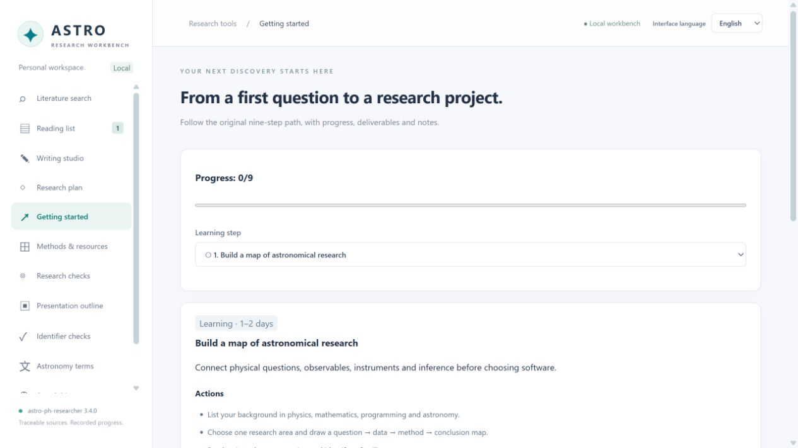

# astro-ph-researcher 3.4.0

**本地双语天文研究工作台 · Local bilingual astronomy research workbench**

[中文使用说明](codex/README-3.4.zh.md) · [English guide](codex/README.en.md) · [3.4.0 发布说明](RELEASE_NOTES.md) · [GitHub 发布步骤](docs/PUBLISH-3.4.md)

将文献、写作、新手路径、研究计划和研究资料放在 Codex 可打开的本地窗口里，同时保留原插件的 DSH 宿主/客户端、9 个 skills、离线数据与 CLI。数据保存在用户本机；Codex 窗口不要求 DSH，不自动调用模型或上传个人笔记。



## 快速使用 / Quick start

需要 Node.js 22+。无需 `npm install`。

```sh
npm run ui
```

打开终端打印的本地 URL。Windows 可双击 `codex/start-ui.cmd`；英文入口为 `codex/start-ui-en.cmd`。

For an English interface, run `node codex/scripts/open-ui.mjs --lang en`, or double-click `codex/start-ui-en.cmd` on Windows. The language can also be changed in the UI without rewriting your scientific content.

## 在 Codex 主界面提供可点击入口

本版本采用官方支持的 **项目顶栏操作按钮**。它随包分发，用户为各自项目安装后可点击启动服务并打开工作台：

```sh
node codex/scripts/install-action.mjs --project "你的 Codex 项目目录" --lang zh
```

English: use `--lang en` to install the **Open Astro Workbench** action. Windows users may run `codex/install-button-en.cmd` or `codex/install-button-zh.cmd`. Reopen the target project in the Codex desktop app after installation.

配置保留现有操作并在修改前备份。源码目录已有相对路径 `.codex/environments/environment.toml` 模板，可直接作为 Codex 项目使用。插件/skill 安装本身不保证创建全局侧栏按钮，不能把 ChatGPT 的侧栏扩展当成 Codex 保证支持的接口。[官方操作文档](https://learn.chatgpt.com/docs/environments/local-environment)

## 功能 / Features

| 模块 | 本地窗口能力 |
| --- | --- |
| 文献 / Literature | Crossref/arXiv 检索、筛选、DOI/arXiv 核验、来源快照、去重、阅读清单及 BibTeX/Markdown/JSON 导出 |
| 写作 / Writing | 期刊/学位项目、10 种写作目标、真实材料、文本导入、10 章节编辑器、启发式检查、作者确认、Markdown 和 Codex 交接 |
| 新手 / Learning | 九步研究路径、检查项、交付物、笔记、进度；英文配套路径 |
| 计划 / Planning | 节点、上级依赖、状态、来源和交付标准；循环依赖检查 |
| 资料 / Resources | 34 方法、9 统计、30 设施、分析工具、公开源表、8 条推荐书目 |
| 研究检查 / Research checks | 9 个领域的盲点问题及笔记 |
| 汇报 / Briefing | 从阅读清单和计划生成 Markdown 大纲及演示文稿交接提示词 |
| 设置 / Settings | 中英文界面、完整工作区备份 |

英文界面、按钮和主要工作流已翻译；原始方法/设备等详细资料保留原语言并明确标注。用户的正文、笔记、原始题录永不因切换语言而自动翻译。

**科研边界**：题录存在不证明科学论断、同行评议或未撤稿；启发式评分不验证科学正确性；作者本人须核对并确认各节。网页为模型写作准备交接提示词；不声称已自动生成论文。汇报导出是 Markdown，不是 PPTX。投稿前核对当年官方指南。

## 插件与原功能

在 [v3.4.0 下载页](https://github.com/wing-tn/astro-ph-researcher/releases/tag/v3.4.0) 选择 `*-dsh.zip`（完整 DSH bundle，同时保留 Codex 目录）或 `*-codex-zh.zip` / `*-codex-en.zip`（独立 Codex 插件，中/英文默认入口）。`*-source.zip` 是同版完整源码；DSH 包与源码包内容相同，另有独立说明和 SHA256 校验文件。

DSH 用户解压后，在包含 `package.json` 的目录运行：

```sh
dsh plugin --profile desktop add .
```

完全退出并重启 DSH。使用 `web` profile 的用户将 `desktop` 替换为 `web`。详见 [DSH 3.4.0 安装与升级](docs/INSTALL-DSH.md)；完整原功能说明保留在 [历史说明](docs/README-before-3.4.md)。

Codex 插件清单位于 `codex/.codex-plugin/plugin.json`。在完整源码目录可按本机 CLI 支持的命令配置本地 marketplace：

```sh
codex plugin marketplace add .
codex plugin add astro-ph-researcher@astro-ph-researcher-local
```

安装/更新缓存的行为依赖本机 CLI；先备份个人数据并查阅 `codex plugin --help`。本次发布不自动替换用户已安装缓存。9 个原 skills 的内容保持一致；离线 CLI 仍可单独运行：

```sh
node codex/scripts/astro-cli.mjs stats
node codex/scripts/astro-cli.mjs beginner
node codex/scripts/astro-cli.mjs goal refutation
```

## 开发与数据

```text
codex/ui/public/         双语窗口
codex/ui/workspace.mjs  写作/新手/计划的本地服务
codex/ui/core.mjs       文献适配、核验、存储与导出
codex/ui/sections.mjs   复用原插件的章节、评分和作者确认逻辑
codex/scripts/         启动器、项目按钮安装器、原离线 CLI
lib/                    原 DSH 功能（保留）
```

```sh
npm test
npm run test:ui
```

阅读清单为 `codex/ui/local-data/library.json`，其余工作区为同目录 `workbench.json`；与原 DSH 库独立。升级前在设置页下载备份。发布脚本排除个人数据和临时文件。验收范围及限制见 [VALIDATION.md](codex/VALIDATION.md)。

## 声明、致谢与用户反馈

Copyright © 2026 天外奇航（@hyperskysail，GXU-CN）。代码与文档等采用 AIGC 辅助，科学内容仍需人工核验。作者以非盈利方式维护，现有功能免费；这一立场不缩减 MIT 许可权利。第三方资料与商标归各自权利人，致谢不表示官方背书。

**用户反馈 QQ 交流群：1126615665** · 1253932197@qq.com · [GitHub Issues](https://github.com/wing-tn/astro-ph-researcher/issues)

完整内容见 [版权/AIGC/免责/非盈利声明](DISCLAIMER.md)、[作者与贡献](AUTHORS.md)、[致谢](ACKNOWLEDGMENTS.md)、[反馈与支持](SUPPORT.md) 和 [隐私说明](PRIVACY.md)。软件仍按原 [MIT License](LICENSE) 提供。
