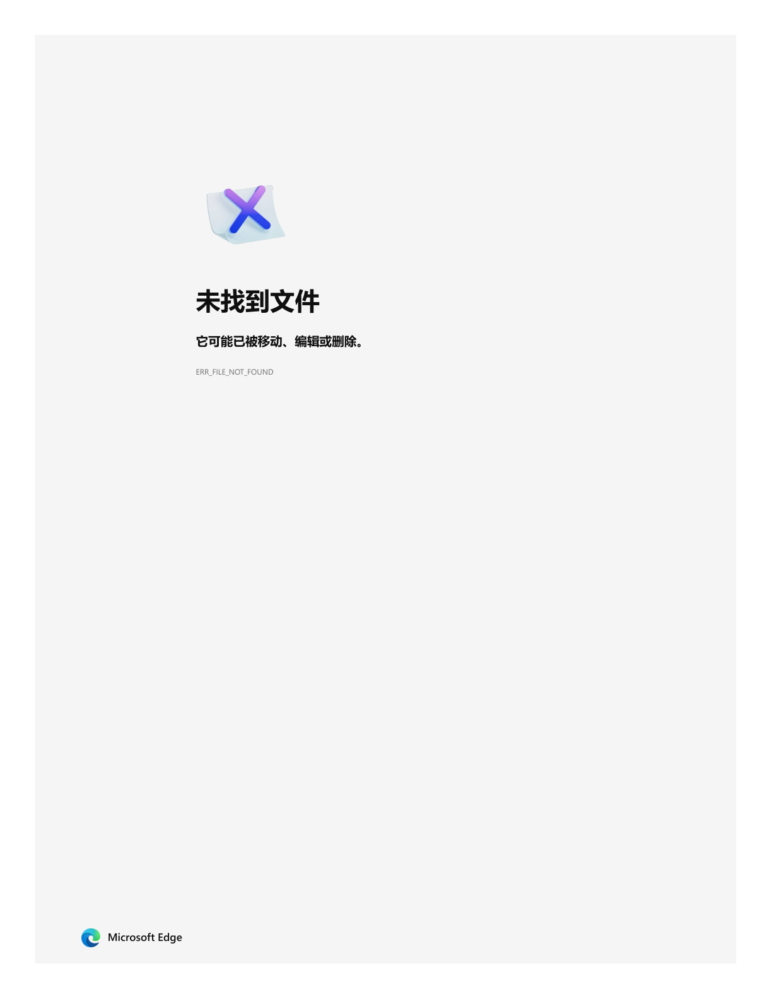
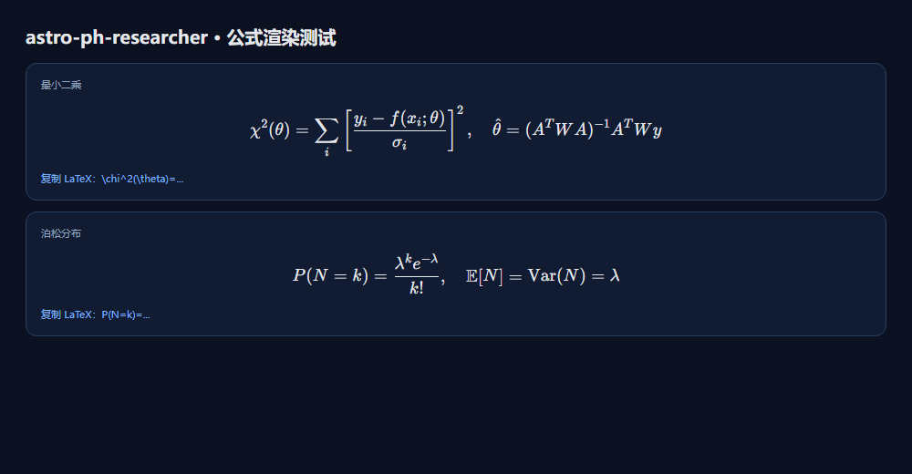

# astro-ph-researcher v2.0 · 天文研究工作台

> **作者 / 所有者**：天外奇航（@hyperskysail，1253932197@qq.com，GXU-CN）
> **创作记录**：[AUTHORS.md](AUTHORS.md) · [版本备份说明](backups/README.md)
> **记录日期**：2026-10-22（Asia/Shanghai）

> **AI 内容声明**：作者只负责设计；代码、文案、数据由 AI（DeepSeek/DSH）制作，作者验收。AI 存在幻觉，内容可能错误、过时或链接失效；请用户独立核验。报错/侵权请联系 **1253932197@qq.com** 更新或删除。详见 [DISCLAIMER.md](DISCLAIMER.md)。

> 面向天文学本科生、研究生、研究员与教师的 DSH 插件。三步闭环：
> **查准术语（NADC 审定译名/定义）→ 找对文献并建立可核验的参考文献库 → 基于研究结果与引用文献写作英文期刊论文或学位论文。**

本仓库是可直接安装的 DSH 双端插件（Host + Client）。v2.0 保留 v1.0.1 全部功能，并新增逐节写作、评分、作者确认、物理书目、文件格式与分析工具引导。

---

## 1. 它解决什么问题

读英文天文文献、写论文时，中国学生/研究者最常见的卡点：

1. **术语译名不统一**：gravitational lens / lensing、proper motion、metallicity……不同教材、不同译者写法不同，直接机翻还可能是错的。
2. **文献太多、排序没有依据**：Google Scholar 按引用数排，最新综述被淹没；按时间排，经典又被淹没；读完之后没有可复用的文献库。
3. **查完之后无法继续**：复制 DOI、打开 PDF、再切到对话里解释；写论文时又要重新找文献、重排引用、猜期刊模板。

本插件把这条链路收进 DSH 侧边栏：

- **查词**：输入英文或中文，实时查 [国家天文台天文学名词库（NADC）](https://nadc.china-vo.org/astrodict/)，给出审定中文名、台湾名、出版状态、依据书目、最后修订时间、词条链接与相关术语。**若该词条带《天文学名词（定义版）》的定义，会原样展示“NADC 审定定义”，并与 DSH 释义分开。**
- **同名词条消歧**：当一个英文/中文名对应多个 NADC 词条时（如 gravitational lensing、transit），列出“同名词条 / 其他译名”，点击切换，保存时记录选中的词条 id。
- **官方离线词表**：设置页可一键下载 NADC 官方全量词表（约 700 KB，3 万条 EN↔ZH），断网也能查；不随插件分发，遵守 NADC 许可。
- **文献检索**：按“相关性为主、时间次之、引用数再次”的综合评分检索英文文献，也可切换纯相关性 / 最新 / 高引。每条给 DOI、SciX、ADS、arXiv、OpenAlex、Google Scholar 链接、摘要、评分分解与“为什么相关”。
- **参考文献库**：把检索结果保存到本地文献库，保留前三位作者（姓名/ORCID）、单位、期刊卷期页、DOI/SciX/ADS/arXiv、摘要、总结、关键结果、领域/关键词/专题标签；支持研究者修改归类，按 BibTeX/APA/GB 7714/MLA 复制引用或导出 `.bib`。
- **写作工作台**：创建英文期刊论文/学位论文项目，上传多个研究结果文件，选择目标 SCI 期刊（官网/作者指南/Overleaf 模板）或中国高校学位论文格式（年份版本/规范链接/GB 7714），交给 DSH 做结果分析、写作大纲、逐节起草与格式检查。
- **学位论文格式材料**：选中高校/中科院院所后，由宿主侧搜索官方页、下载格式/模板到本地，自动解析 DOCX/TXT/ZIP；PDF/DOC 交给 DSH 阅读；也支持作者自己上传格式/模板并解析。
- **目标感知写作**：10 种主流目标（首次发现/独立确认/批判反驳/跟进增量/零结果上限/方法软件/巡天星表/理论模型/多信使/综述观点），按证据门槛、标题/摘要动作、期刊匹配与审稿人风险选择不同叙述风格；提供 `audit` 投稿前红队。
- **交给 DSH**：单篇“分析这篇”或多选“交给 DSH 分析所选”，自动把题录 + 摘要 + 分析模板注入当前对话；也可对术语发起“在对话中搜索”，调用 `session_search` 找回之前讨论过的内容。
- **术语本**：保存、搜索、导出 Markdown / CSV / Anki；点击打开 NADC 原链接。
- **知网**：给出人工检索深链（总库 + 知网搜索），明确说明没有公开 API、不绕过登录/付费墙。
- **9 个提示词 skill**：4 个基础 + 4 个写作目标 + 1 个 v2 研究流程（评分/逐节/确认/格式/工具）。
- **公式渲染**：方法/统计公式用本地 KaTeX 编译为数学形式显示；每个公式都有“复制 LaTeX”和“查看/粘贴 LaTeX”源码选项，断网也能用。
- **数据处理方法库**：整理通用天文数据处理与统计方法：图像处理、统计基础、误差/置信区间、最小二乘、周期分析、最大似然、贝叶斯/MCMC、机器学习与 VO；附独立编写的 Python 示例；不包含书籍/章节信息。
- **观测设备/数据工作流库**：Chandra、Fermi-LAT/GBM、Swift、XMM-Newton、NuSTAR、JWST、HST、Gaia、TESS、ALMA、VLA、IceCube、LIGO/Virgo/KAGRA、H.E.S.S. 等；FAST/LHAASO/IXPE 等受限设施给申请/分析建议；在建/规划项目单列；支持保存个人工作流与交给 DSH 设计流程。
- **Codex 版**：`codex/` 提供 Codex 插件清单、9 个 skill、只读数据与离线 CLI；不依赖 DSH 运行时，已在本机 Codex CLI 0.149.0-alpha.4.3 安装验证。
- **演示材料**：[介绍 PDF](presentation/astro-ph-researcher.pdf) / [PPTX](presentation/astro-ph-researcher.pptx) / [HTML](presentation/astro-ph-researcher.html)。

---

## 2. 预览





- [介绍 PDF（12 页，16:9）](presentation/astro-ph-researcher.pdf)
- [可编辑 PPTX](presentation/astro-ph-researcher.pptx)
- [浏览器放映版 HTML](presentation/astro-ph-researcher.html)
- 静态侧边栏预览（示例数据，不请求真实 API）：[`demo/index.html`](demo/index.html)

真实插件从 `/api/astro-ph-researcher/*` 拉取数据；预览与插件共用同一套 CSS。

## 3. 安装（v2.0.0）

### 3.1 前置

- DSH 桌面版（本工作区验证版本：DeepSeek Harness，2026-10 构建）
- 插件目录：`F:\dsh插件\astro-words`
- 节点：DSH 自带 Node（无需全局 npm）

### 3.2 从 GitHub 安装

```bash
git clone https://github.com/wing-tn/astro-ph-researcher.git
cd astro-ph-researcher
dsh plugin --profile desktop add .
```

> 包名是 `astro-ph-researcher`，不是 npm 包；DSH 通过本地 bundle 加载。
> 如果你的 DSH 版本把 profile 命名为 `web`，把 `desktop` 换成 `web`。
> 本机开发目录仍是 `F:\dsh插件\astro-words`，所以下面的本地脚本安装仍可用。

### 3.3 本地脚本安装（CLI 路径解析异常时）

在 Windows PowerShell：

```powershell
cd "F:\dsh插件\astro-words"
node scripts/install-local.mjs
```

脚本会建 junction（失败则复制）到 profile 的 `node_modules`，并把 `astro-ph-researcher` 加入 `dsh.profile.bundles`。卸载：`node scripts/install-local.mjs --remove`。

### 3.4 手动安装（CLI 不可用且不想用脚本时）

1. 编辑 `%USERPROFILE%\.dsh\profiles\desktop\package.json`：
   - 在 `dependencies` 增加：`"astro-ph-researcher": "link:<你的克隆目录>"`
   - 在 `dsh.profile.bundles` 数组末尾增加：`"astro-ph-researcher"`
2. 在该目录执行 `npm install`（或让 DSH 重新加载 profile）。
3. 完全退出并重启 DSH（Host 端新增工具与 HTTP 路由，需要重启）。

### 3.5 验证

- 侧边栏底部出现「天文术语」按钮（轨道图标）。
- 点击后打开浮窗；「设置」页应显示 `astro-ph-researcher v2.0.0`。
- 当前版本实测可热加载；若没有出现，刷新页面；仍没有则完全重启 DSH。
- 在对话中问「redshift 的中文名是什么？」应触发 `astro_term_lookup`。

### 3.6 卸载

```powershell
& "E:\DSH\resources\runtime\cli\bin\dsh.cmd" plugin --profile desktop remove astro-ph-researcher
```

或 `node scripts/install-local.mjs --remove`。术语本数据保留在 `%USERPROFILE%\.dsh\astro-ph-researcher\`，可手动删除。

### 3.7 Codex 版

`codex/` 是一个可安装的 Codex 插件，包含 9 个 skill、只读数据与离线查询 CLI。已在本机 **Codex CLI 0.149.0-alpha.4.3** 实测安装：

```bash
git clone <your-repo> astro-ph-researcher
cd astro-ph-researcher
codex plugin marketplace add .
codex plugin add astro-ph-researcher@astro-ph-researcher-local
codex plugin list
```

应看到 `astro-ph-researcher@astro-ph-researcher-local  installed, enabled  1.0.0`。

只装 skill（不启用插件）：

```bash
bash codex/install-skills.sh
# 或 PowerShell: .\codex\install-skills.ps1
```

Codex 中按命名空间调用：

```text
Use $astro-ph-researcher:astro-literature-research to build a verifiable reading list for ...
Use $astro-ph-researcher:astro-code-writing to write a reproducible Python analysis for ...
```

离线数据查询：

```bash
cd codex
node scripts/astro-cli.mjs stats
node scripts/astro-cli.mjs instrument FAST
```

详见 [codex/README.md](codex/README.md) 与 [codex/AGENTS.md](codex/AGENTS.md)。

---

## 4. 使用

### 4.1 查词

1. 侧边栏「天文术语」→ 查词。
2. 输入 `redshift` 或 `红移`。
3. 得到：
   - 审定译名：红移（台湾名：紅移）
   - 状态：已出版
   - 依据：《英汉天文学名词》2000 / 2015、《天文学名词（第三版）》2024 等
   - **NADC 审定定义（若有）**：(1) 天体谱线的观测波长向长波方向频移的现象。(2) 该现象引起的谱线波长的相对改变量。
   - NADC 词条链接（可点击打开）
   - 相关术语：测光红移、宇宙微波背景、引力透镜效应、宇宙学红移……
4. 可「保存到术语本」「搜相关文献」「交给 DSH 讲解」「在对话中搜索」。

> NADC 详情页不一定每条都有定义：有定义版原文时，插件原样展示并标“名词委原文”；没有时明确写“该词条未提供定义字段”。插件输出的「DSH 释义」是生成的物理学解释，不是名词委原文；UI、工具输出和导出文件都会明确标注。
>
> 若同名/近名对应多个词条，会出现「同名词条 / 其他译名」，点击即可切换并记录选中的 NADC id。设置页可下载官方全量离线词表（约 3 万条），断网时作为查词兜底；离线词表不含 id/定义，联网后会补全。

### 4.2 文献检索

1. 输入英文检索式，例如 `gravitational lensing galaxy clusters`。
2. 默认「综合」排序：`0.60 × 相关性 + 0.25 × 时间衰减 + 0.15 × log(引用数)`；可在设置里开「严格优先级」，此时相关性 5% 一档，档内先时间后引用。
3. 可切换：
   - 相关：只看相关性
   - 最新：按发表时间
   - 高引：按引用数
4. 可用年份、最低被引、开放获取、是否含预印本过滤。
5. 每条结果可单独「分析这篇」，或勾选多篇后「交给 DSH 分析所选」。

### 4.3 交给 DSH 分析

- 点击后 Host 端通过 `agent.steer(createUserMessage(...))` 把分析包注入当前对话。
- 分析包强制要求：
  - 只使用给定题录/摘要，缺失就写“摘要未提供”，不得编造
  - 区分“论文原文”与“推断”
  - 关键结论附 DOI
  - 公式给符号、单位、适用条件
  - 输出可复现性清单与下一步英文检索词
- 当前没有活跃对话时，提示词会复制到剪贴板，不会静默丢失。

### 4.4 术语本

- 保存后写入 `%USERPROFILE%\.dsh\astro-ph-researcher\terms.json`（原子写，防损坏）。
- 支持搜索、标签、删除、Markdown / CSV / Anki 导出。
### 4.5 参考文献库

- 在「文献」页每条结果点「保存到文献库」；也可在对话中调用 `astro_reference_save`。
- 保存内容：标题、前三位作者（姓名/ORCID）、单位、期刊卷期页、DOI/SciX/ADS/arXiv、摘要、分析总结、可引用关键结果、领域/关键词/专题标签。
- 「文献库」页支持搜索、按标签过滤、编辑归类、删除、导出 BibTeX。
- 引用格式：BibTeX（Overleaf）、APA、GB/T 7714（中文学位论文）、MLA；复制或导出 `.bib`。
- 本地文件：`%USERPROFILE%\.dsh\astro-ph-researcher\references.json`。

### 4.6 写作工作台

1. 新建项目：选择「英文期刊论文」或「学位论文」，选目标期刊/高校格式与语言。
2. 上传研究结果：支持多文件（文本/CSV/JSON/TeX/Bib 直接读文本；其他二进制按 base64 保存，单文件 ≤8 MB）。
3. 可选「上传后让 DSH 分析这些结果」。
4. 选择目标后可直接打开期刊作者指南/Overleaf 模板，或高校格式要求链接。
5. 点击「分析研究结果」「生成写作大纲」「逐节起草」「检查格式」，DSH 会把项目、文件预览、文献库与目标格式整理成提示词。
6. 格式库支持粘贴/上传格式要求，保存为自定义学校格式；可导出/导入 JSON 格式包共享。
7. **学位论文格式材料**：选中高校/中科院院所后，客户端自动检查本地 workspace，没有则自动抓取官方页/附件（也可手动重试）；宿主会下载到本地到 `%USERPROFILE%\.dsh\astro-ph-researcher\formats\<id>\`，DOCX/TXT/ZIP 自动解析，PDF/DOC 标记为需 DSH 阅读。也可自己上传格式/模板（PDF/DOCX/DOC/TXT/ZIP）后解析，并一键「交给 DSH 解析/使用」。
8. 当前版本不提供云端账户同步；“供他人使用”通过导出格式包 + 共享文件实现。

### 4.7 提示词 skill

插件注册 9 个 skill（可在 DSH 技能目录直接看到）：

- `astro-literature-research`：检索源、ADS/SciX/arXiv 语法、证据分级、精读模板、文献库字段。
- `astro-code-writing`：数据契约、astropy 单位/常数、统计推断、图表、测试与复现。
- `astro-english-journal-writing`：选刊、标题/摘要/关键词、各节写作、图表、修订与返修。
- `astro-phd-thesis-writing`：学校格式/GB 7714、章节骨架、创新点、综述、摘要、查重/盲审/答辩。
- `astro-writing-goals`：10 个写作目标选择器；标题/摘要/证据门槛/期刊匹配。
- `astro-discovery-writing`：首次发现、独立确认、多信使。
- `astro-critical-writing`：批判/反驳、零结果/上限。
- `astro-incremental-method-writing`：跟进增量、方法软件、巡天、理论、综述。

文件在 [`skills/`](skills/)；主机启动时通过 `ctx.skills.register` 注册。

### 4.7.1 v2 新增（在 v1.0.1 基础上）

- **逐节写作**：10 个章节状态机（todo → ai_draft → author_editing → needs_evidence → ready_for_review → author_confirmed → locked）。
- **评分**：文献 6 维、章节 6 维启发式评分；可解释、可覆盖。
- **作者确认**：客户端按钮 + 四项核对 + contentHash/rubricVersion；内容改变自动失效；AI 不能代替确认。
- **文件格式百科**：FITS/PHA/RMF/ARF/Fermi XML/VOTable/ECSV 等。
- **物理书目**：Landau 十卷、相对论/黑洞/中子星/辐射转移/恒星/AGN/GRB/中微子/引力波。
- **分析工具引导**：3ML、AM³、SED Builder、DS9、Geant4；公开源表目录。

### 4.8 数据处理与观测设备

「数据」页分四个子页：

- **数据处理方法 / 统计原理**：34 个方法 + 9 条统计卡片；按类别/关键词搜索；展开可看原理、公式、假设、步骤、独立 Python 示例、常见坑。
- **观测设备/数据**：按状态（运行/在建/规划/提案）与数据政策（开放/受限/专有期/闭源）筛选；每条给官方数据归档、分析软件、工作流与建议。
- **我的工作流**：把设施的步骤保存到本地，或点「交给 DSH 设计/检查流程」注入当前对话。

工具：`astro_data_method`、`astro_data_instrument`、`astro_data_workflow`。

## 5. 数据源与证据链

| 用途 | 来源 | 是否需要 key | 说明 |
|---|---|---|---|
| 中文译名核验 | NADC 天文学名词（国家天文台） | 否 | HTML 检索页 `/astrodict/fuzzy?word=` 与详情页 `/astrodict/termdetails?id=`；部分词条含“定义/备注/范例/标签”字段 |
| 英文学术文献 | [OpenAlex](https://api.openalex.org/) | 否（建议 mailto；可配 key） | 覆盖全、有 `relevance_score`、引用数、OA 链接、摘要倒排索引；无 key 免费额度按 IP 共享（约 $0.10/天），耗尽会 401 |
| 备用文献源 | [Crossref](https://api.crossref.org/) | 否（建议 mailto） | 出版元数据权威，摘要常为 JATS XML；相关性字段是 `score` |
| 天文专业引文库 | [NASA ADS](https://ui.adsabs.harvard.edu/) | 是（`ADS_API_TOKEN`） | 天文学最完整的引用与收录；未配置时自动回退 OpenAlex |
| 天文专业索引 | [SciX](https://scixplorer.org/) | 否 | 每条文献生成 SciX 检索链接；用户可跳转到具体文献 |
| 预印本 | [arXiv astro-ph](https://arxiv.org/) | 否 | 按需选择；与正式版按 DOI/标题去重 |
| 期刊格式 | `data/journals.seed.json` | 否 | 14 个天文/物理期刊的官网、作者指南、Overleaf 模板、引用风格；反爬导致部分 `verified:false` |
| 高校格式 | `data/thesis-formats.seed.json` | 否 | 21 个单位（高校/中科院院所）的学位论文格式（年份版本/规范链接/GB 7714）；18 条已验证，武汉大学/清华/南大未找到公开官方页，已标 `verified:false` |
| 数据处理方法 | 通用天文数据处理与统计知识（不含书名/作者/出版社/ISBN/章节） | 否 | 只保留方法、公式、假设、步骤、独立 Python 示例与常见坑 |
| 观测设备/数据 | `data/instruments.seed.json` | 否 | 30 个设施的官方数据/分析入口、软件、工作流、开放/受限政策与在建/规划状态；每个 URL 尽量实测并标 `verified` |
| 写作目标/风格 | `data/writing-goals.seed.json` | 否 | 10 个主流目标（发现/确认/反驳/增量/上限/方法/巡天/理论/多信使/综述）；含证据门槛、标题/摘要动作、期刊匹配、示例 DOI |
| 学位论文 | 知网（CNKI） | 机构登录 | **无公开 API**；`kns.cnki.net` 全站 `Disallow` 且常触发滑块验证，`search.cnki.com.cn` 可直接打开但结果前端渲染；只给人工检索链接，不抓取、不绕过付费墙 |
| 离线词表 | `data/terms.seed.json` | 不需要 | 29 条常用术语，NADC 逐条核验；含 21 条《定义版》原文，网络失败时降级 |
| 官方全量词表 | [NADC 词典下载](https://nadc.china-vo.org/astrodict/article/download) | 不需要 | 官方 zip（r241020，696 KB，30,094 条 EN→ZH / 26,770 条 ZH→EN），解析后约 31,758 条。设置页一键下载；许可允许集成但**禁止修改内容或与其他词库整合后二次发布**，因此不随插件打包 |

> 引用数会随数据库与日期变化。插件在结果中保留 `sourceUsed` 与检索时间，导出检索结果时也会记录，便于复现。
>
> 完整的实测数据源报告见 [`research/data-sources.md`](research/data-sources.md)；期刊/Overleaf 模板实测见 [`research/journals.md`](research/journals.md)；高校格式实测见 [`research/thesis-formats.md`](research/thesis-formats.md) 与 [`research/thesis-formats-additions.md`](research/thesis-formats-additions.md)；观测设备/数据链接实测见 [`research/instruments.md`](research/instruments.md)。

---

## 6. 目录结构

```
astro-ph-researcher/
├─ lib/
│  ├─ index.js        # Host：14 个 agent 工具 + loopback HTTP API + 分析/写作交接
│  ├─ client.js       # Client：侧边栏入口 + 浮窗（查词/文献/文献库/写作/术语本/设置）
│  ├─ astrodict.js    # NADC 检索、解析、匹配、相关词、同名词条
│  ├─ dictionary.js   # 官方词表下载 / zip 解析 / 离线索引
│  ├─ literature.js   # OpenAlex / Crossref / ADS / arXiv + 排序 + 分析模板
│  ├─ references.js   # 参考文献库 + BibTeX/APA/GB 7714/MLA
│  ├─ writing.js      # 写作项目/文件上传/期刊与高校格式/写作提示词
│  ├─ data-library.js # 数据处理方法/观测设备/个人工作流
│  ├─ skill-files.js  # 随包 SKILL.md 发现与注册
│  ├─ seed.js         # 本地词表加载
│  ├─ store.js        # 术语本 + 配置持久化（原子写）
│  └─ util.js
├─ data/
│  ├─ terms.seed.json          # 29 条已核验术语种子
│  ├─ journals.seed.json       # 14 个天文/物理期刊与 Overleaf 模板
│  ├─ thesis-formats.seed.json # 21 个高校/中科院院所学位论文格式
│  ├─ data-methods.seed.json   # 34 方法 + 9 统计（版权安全版，无书籍元数据）
│  ├─ instruments.seed.json    # 观测设备/数据/软件/工作流/开放政策
│  └─ README.md
├─ skills/
│  ├─ astro-literature-research/SKILL.md
│  ├─ astro-code-writing/SKILL.md
│  ├─ astro-english-journal-writing/SKILL.md
│  ├─ astro-phd-thesis-writing/SKILL.md
│  ├─ astro-writing-goals/SKILL.md
│  ├─ astro-discovery-writing/SKILL.md
│  ├─ astro-critical-writing/SKILL.md
│  └─ astro-incremental-method-writing/SKILL.md
├─ test/
│  ├─ smoke.mjs       # 解析、排序、分析模板、持久化
│  ├─ dictionary.mjs  # 词表 TSV / ZIP 解析测试
│  ├─ references.mjs  # 文献库/引用格式测试
│  ├─ writing.mjs     # 项目/文件/格式库测试
│  ├─ skills.mjs      # 9 个 skill 发现/注册测试
│  ├─ host-smoke.mjs  # 用 mock ctx 验证工具/路由注册
│  └─ client-smoke.mjs# 验证 client bundle 与 slot 注册
├─ docs/
│  ├─ 01-第一步设计与优化.md
│  ├─ 02-安装与验证.md
│  ├─ 03-完整路线图.md
│  ├─ 04-第二步-参考文献库.md
│  ├─ 05-第三步-写作工作台.md
│  ├─ 06-提示词skill.md
│  ├─ 07-天文数据处理方法库.md
│  ├─ 08-观测设备与数据工作流.md
│  ├─ 09-书籍分析总结.md
│  ├─ 10-交付审计与已知缺口.md
│  ├─ 11-发布指南.md
│  ├─ 12-写作目标与风格.md
│  ├─ 13-发布与打赏.md
│  ├─ 14-v2-路线图.md
│  ├─ 15-v2-物理与天文书籍库.md
│  ├─ 16-公式渲染与复制.md
│  ├─ 17-v2-分析工作流与文件格式.md
│  └─ 19-U盘安装与迁移.md
├─ demo/               # 静态侧边栏预览（与真实插件共用 CSS）
├─ presentation/       # 介绍 PDF / PPTX / HTML / JSON / 封面
├─ codex/              # Codex 插件、9 个 skill、数据与离线 CLI
├─ .agents/plugins/    # Codex 本地 marketplace 清单
├─ assets/screenshots/ # GitHub / DSH 市场截图
├─ submission/         # awesome-dsh-plugin 提交模板
├─ research/           # 数据源/期刊/高校格式实测报告与原始探针
├─ provenance/         # 对话日志、日期、SHA-256 清单与作者声明
├─ scripts/live-check.mjs
├─ scripts/dict-check.mjs
├─ scripts/install-local.mjs
├─ scripts/build-demo.mjs
├─ package.json
├─ cordis.patch.yml
├─ AUTHORS.md          # 作者身份与待签字声明
├─ CITATION.cff        # 引用元数据
├─ CHANGELOG.md
└─ README.md
```

---

## 7. 本地验证

```bash
node test/smoke.mjs
node test/dictionary.mjs
node test/host-smoke.mjs
node test/client-smoke.mjs
node scripts/live-check.mjs redshift
node scripts/dict-check.mjs          # 首次会真实下载约 700 KB 官方词表
```

`live-check` 会真实访问 NADC 与 OpenAlex，用来检查接口是否变化。

---

## 7.5 v2.0 已实现的基础

已实现：**逐节状态机、文献/章节启发式评分、DSH 内逐段编辑、作者确认台账、文件格式百科、物理书目、3ML/AM³/SED/DS9 引导**。

仍为后续：**完整 diff/多作者确认、自动 TAP/VizieR 下载、自动运行 3ML/AM³ 重型计算、把评分做成经人工校准的模型**。详见 [docs/14-v2-路线图.md](docs/14-v2-路线图.md)。

## 8. 已知限制（当前版本）

- 文献分析与写作提示词主要基于**题录 + 摘要 + 用户上传的文本**，不抓取付费全文；全文精读可接 `dsh-literature` 的 PDF 阅读器（后续版本）。
- **SCI 收录状态无法从 OpenAlex/Crossref 直接判定**。插件用“期刊论文/综述类型 + 期刊来源 + 引用数”做近似筛选，不声称某篇“已被 SCI 收录”；若需要严格 SCI 名单，需接入 Web of Science/Scopus（授权）或自建期刊白名单。
- 知网没有公开 API；不做登录态抓取。
- 中文检索词只有在 NADC 命中时才会自动转英文；任意中文短语的翻译需要逐步扩展领域词典（见优化文档）。
- ADS 需自备 token；无 token 时用 OpenAlex，引用数口径会不同。
- OpenAlex 无 key 的免费额度按 IP 共享；额度耗尽（HTTP 401）时自动回退 Crossref。建议设置 `ADS_API_TOKEN` / `OPENALEX_API_KEY`。
- 官方全量离线词表需你在设置页主动下载（约 700 KB / 3 万条）；不随插件打包，遵守 NADC “不得修改内容或与其他词库整合后二次发布”的许可。
- 术语释义是 DSH 生成的物理讲解，不是名词委原文；**只有标注“NADC 审定定义”的段落才是名词委原文**。审定译名与定义以 NADC 链接为准。
- 参考文献库保存在本机，不提供云端账户同步；可通过 `references.json` 备份/迁移。
- 写作工作台不自动生成整篇论文；由 DSH 按项目提示词与 skill 起草，用户审阅。PDF/DOCX 格式文件不直接解析，只读取文本类格式要求；不操作 Overleaf 账号。
- 期刊/高校格式数据带 `verified` 标记；出版商反爬导致部分链接未能在线验证，使用前请点开确认。
- 数据处理方法库是**章节/方法摘要**，不是原书全文；公式与 Python 示例为独立整理/实现，具体符号约定以原书为准。
- 观测设备库只给官方入口/软件/工作流建议，不代为申请数据、不绕过专有期/登录/付费墙；`verified:false` 的条目需自行确认。
- 在建/规划设施当前没有可分析数据，不能当成运行设施使用；状态以官方页面与调研日期为准。
- 观测设备是 **30 个 curated 条目**，不是全世界穷举；未覆盖 Spitzer/Herschel/Euclid/KM3NeT/CSST 等。
- **本会话没有在登录态 Web GUI 里逐个点击验收**；client slot 已注册、源码/注册测试通过，但首次使用请刷新页面，若没有「数据」页则重启 DSH。
- 安装是当前 profile 的 junction + bundle，**未在全新 profile 上做干净安装测试**。
- 书籍的 Python 代码未逐段对齐原书；插件示例为独立实现，原书代码需要你提供 PDF/扫描后再核对。
- 详细审计见 [docs/10-交付审计与已知缺口.md](docs/10-交付审计与已知缺口.md)。

---

## 9. 发布

- 正式发布包：`dist/astro-ph-researcher-1.0.0.zip`、`.tar.gz`、`SHA256SUMS`、`RELEASE_NOTES.md`。
- GitHub 上传、Release、topic 与 DSH 插件市场 PR：见 [docs/11-发布指南.md](docs/11-发布指南.md)。
- DSH 市场条目模板：`submission/awesome-dsh-plugin/hyperskysail__astro-ph-researcher.yml`。
- GitHub 截图：`assets/screenshots/`，由 `screenshots.json` 声明。

---

## 9.5 推荐书籍、致谢、隐私与安全

- 推荐书籍：中文/译著 + 英文权威书目；只列书目元数据，不提供原文/摘要/下载。
- 版权声明：非盈利开源；版权归作者/出版社；如有侵权请联系 1253932197@qq.com 删除。
- 致谢：[ACKNOWLEDGMENTS.md](ACKNOWLEDGMENTS.md)（DeepSeek/DSH、NADC、OpenAlex/Crossref/ADS/arXiv、KaTeX、全世界天文工作者）。
- 隐私：[PRIVACY.md](PRIVACY.md)；安全：[SECURITY.md](SECURITY.md)。
- 设置页可调「界面宽度」「字体/整体缩放」，并查看隐私/致谢摘要。

## 10. 支持项目（自愿打赏）

本项目免费、开源、不盈利，功能不收费、不设付费墙。如果它节省了你的时间，可以自愿打赏，用于维护、数据更新、测试设备与未来可选的服务成本。

- GitHub 仓库页会显示 **Sponsor** 按钮；入口见 [SUPPORT.md](SUPPORT.md)。
- 微信/支付宝收款码：把图片放到 [`assets/support/`](assets/support/)，并在 [SUPPORT.md](SUPPORT.md) 中替换占位图。
- 不要写“付款后解锁功能/优先支持”；打赏不是购买，不构成服务合同。
- 个人打赏可能涉及税务/平台规则，发布前请自行确认；本项目不提供税务或法律建议。

## 11. 许可与致谢

- 代码：MIT。
- 术语数据：国家天文台天文学名词数据库（NADC），仅作检索与引用；中文译名与《定义版》原文版权归原编纂方。`data/terms.seed.json` 为本地原型数据；公开发布前应按 NADC 许可改为运行期从官方下载，避免“二次发布”风险。
- 文献元数据：OpenAlex（CC0）、Crossref、NASA ADS、arXiv；使用时请遵守各自条款。

---

**下一步阅读**：[第一步设计与优化建议](docs/01-第一步设计与优化.md) · [第二步：参考文献库](docs/04-第二步-参考文献库.md) · [第三步：写作工作台](docs/05-第三步-写作工作台.md) · [提示词 skill](docs/06-提示词skill.md) · [数据处理方法库](docs/07-天文数据处理方法库.md) · [观测设备与数据工作流](docs/08-观测设备与数据工作流.md) · [版权清理说明](docs/09-书籍分析总结.md) · [交付审计与已知缺口](docs/10-交付审计与已知缺口.md) · [发布指南](docs/11-发布指南.md) · [写作目标与风格](docs/12-写作目标与风格.md) · [发布与打赏](docs/13-发布与打赏.md) · [v2 路线图](docs/14-v2-路线图.md) · [v2 物理书籍库](docs/15-v2-物理与天文书籍库.md) · [公式渲染与复制](docs/16-公式渲染与复制.md) · [v2 分析工作流](docs/17-v2-分析工作流与文件格式.md) · [U 盘安装与迁移](docs/19-U盘安装与迁移.md) · [完整路线图](docs/03-完整路线图.md)
